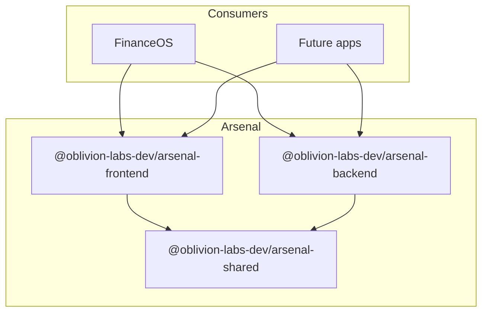

<div align="center">

# Arsenal

**Shared utilities for Oblivion Labs applications**

Type-safe clients, adapters, and helpers — built once, shipped everywhere.

[](https://nodejs.org/)
[](https://www.typescriptlang.org/)
[](https://pnpm.io/)
[](https://github.com/Oblivion-Labs-Dev/Arsenal)

[Packages](#packages) · [Quick start](#quick-start) · [Install in a project](#install-in-a-project) · [Development](#development)

</div>

---

## Overview

Arsenal is a private TypeScript monorepo of reusable building blocks for Oblivion Labs products. It separates concerns into three focused packages so backend services, React frontends, and shared contracts can evolve independently while staying aligned.



| Package | Role | Runtime |
|---------|------|---------|
| `@oblivion-labs-dev/arsenal-shared` | Types, Zod schemas, formatters, constants | Universal |
| `@oblivion-labs-dev/arsenal-backend` | OpenRouter client, logging, retries, API errors | Node.js |
| `@oblivion-labs-dev/arsenal-frontend` | Fetch client, storage hooks, React utilities | Browser / React |

---

## Packages

### `@oblivion-labs-dev/arsenal-shared`

The foundation layer — no I/O, no framework coupling.

| Module | Exports |
|--------|---------|
| **Types** | `Result`, `JSONValue`, `ThemeMode`, `SeverityLevel`, … |
| **Schemas** | `transactionCategorySchema`, `mapToAllowedCategory` |
| **Format** | `formatCurrency`, `formatDate`, `formatPct`, `monthKey` |
| **Date** | `filterByPeriod`, `buildPeriodOptions`, `availableYears` |
| **Constants** | OpenRouter defaults, retry limits, transient HTTP codes |

### `@oblivion-labs-dev/arsenal-backend`

Server-side utilities for APIs, Lambdas, and workers.

| Module | Exports |
|--------|---------|
| **AI** | `OpenRouterClient` — chat completions with JSON parsing |
| **HTTP** | `apiSuccess`, `apiError`, `apiErrorFromUnknown` |
| **Errors** | `AppError`, `isAppError` |
| **Logging** | `Logger`, `truncateForLog`, `endpointLabel` |
| **Utils** | `retry`, `sleep`, `withTimeout`, `safeJsonParse` |
| **Config** | `parseEnv`, `readOpenRouterEnv` |

### `@oblivion-labs-dev/arsenal-frontend`

Browser-safe helpers and lightweight React hooks.

| Module | Exports |
|--------|---------|
| **Storage** | `safeLocalStorage`, `readSeenIds`, session migration |
| **Fetch** | `FetchClient`, `ApiError` |
| **Hooks** | `usePersistedState`, `createThemeHook`, `useDocumentTitle` |
| **Validation** | `validateFileAttachment`, attachment size limits |
| **Download** | `downloadCsv`, `csvFilename` |
| **Utils** | `cn`, `clamp`, `hasKey` |

---

## Quick start

**Prerequisites:** Node.js 20+, [pnpm](https://pnpm.io/installation)

```bash
git clone https://github.com/Oblivion-Labs-Dev/Arsenal.git
cd Arsenal
pnpm install
pnpm run build
```

Verify everything passes:

```bash
pnpm run typecheck
pnpm run test
```

---

## Install in a project

Packages are published to **GitHub Packages** under the `@oblivion-labs-dev` scope.

### 1. Configure registry

Create `.npmrc` in your project root:

```ini
@oblivion-labs-dev:registry=https://npm.pkg.github.com
//npm.pkg.github.com/:_authToken=${NPM_TOKEN}
```

Set `NPM_TOKEN` to a GitHub PAT with `read:packages`.

### 2. Add dependencies

```bash
# Shared contracts
npm install @oblivion-labs-dev/arsenal-shared

# Backend / Node
npm install @oblivion-labs-dev/arsenal-backend

# Frontend / React
npm install @oblivion-labs-dev/arsenal-frontend
```

### 3. Import

**Backend — OpenRouter with structured logging**

```typescript
import { OpenRouterClient, readOpenRouterEnv } from "@oblivion-labs-dev/arsenal-backend";

const env = readOpenRouterEnv(process.env);
const client = new OpenRouterClient({ apiKey: env.OPENROUTER_API_KEY });

const result = await client.chatJson({
  model: "openai/gpt-4o-mini",
  messages: [{ role: "user", content: "Summarize this dataset." }],
});
```

**Frontend — persisted theme with safe storage**

```typescript
import { createThemeHook } from "@oblivion-labs-dev/arsenal-frontend";

export const useTheme = createThemeHook({
  storageKey: "myapp.theme",
  defaultTheme: "dark",
});
```

**Shared — format currency consistently**

```typescript
import { formatCurrency, mapToAllowedCategory } from "@oblivion-labs-dev/arsenal-shared";

formatCurrency(1234.5);            // "$1,234.50"
mapToAllowedCategory("groceries"); // "Food"
```

---

## Repository structure

```
Arsenal/
├── packages/
│   ├── shared/          # Types, schemas, formatters
│   ├── backend/         # Node / server utilities
│   └── frontend/        # Browser / React utilities
├── scripts/
│   └── build.mjs        # Ordered cross-package build
├── .github/workflows/
│   └── publish.yml      # GitHub Packages publish on push
├── pnpm-workspace.yaml
└── tsconfig.base.json
```

Each package builds with **tsup** (ESM + `.d.ts`), tested with **Vitest**, and ships only its `dist/` folder.

---

## Development

| Command | Description |
|---------|-------------|
| `pnpm install` | Install all workspace dependencies |
| `pnpm run build` | Build all packages (Turbo) |
| `pnpm run build:clients` | Build `@oblivion-labs-dev/arsenal-*` clients only |
| `pnpm run dev` | Site builder playground at http://localhost:3100 |
| `pnpm run typecheck` | Type-check every package |
| `pnpm run test` | Run all unit tests |
| `pnpm run clean` | Remove build artifacts |
| `pnpm arsenal` | Site builder CLI (`create`, `add`, `theme`, `preview`) |

For client packages, `scripts/build.mjs` compiles `shared` first so downstream packages resolve types correctly.

---

## Site builder

Config-driven website/app builder — define `site.config.ts` and generate a production-ready site from themes, layouts, sections, motion, and modules.

```
Intent (site.config.ts)
    → @arsenal/config     Zod validation, types, defineSite()
    → @arsenal/themes     CSS variables + Tailwind tokens
    → @arsenal/sections   Hero, Bento, FAQ, CTA, …
    → @arsenal/layouts    Marketing, Dashboard, Docs, Auth, Admin
    → @arsenal/motion     Cursor, reveal, parallax, Lenis, magnetic
    → @arsenal/ui         GlassCard, BentoCard, nav, buttons
    → @arsenal/generator  CLI scaffolding
    → Production Next.js site
```

```bash
cd Arsenal
pnpm install
pnpm build
pnpm dev          # playground at http://localhost:3100
```

Site builder packages live under `packages/site-config` (`@arsenal/config`), `packages/themes`, `packages/sections`, `packages/tokens`, `packages/plugins`, `packages/catalog`, `packages/motion`, etc. Templates are in `templates/`.

### Project blueprints

Declare product intent once — Arsenal resolves layouts, pages, modules, and SEO:

```ts
import { defineProject, resolveProjectToSite } from "@arsenal/config";

const blueprint = defineProject({
  domain: "finance",
  audience: "consumers",
  brand: "FinanceOS",
  capabilities: ["dashboard", "ai-chat", "analytics", "docs", "landing-page"],
});

export const site = resolveProjectToSite(blueprint);
```

```bash
pnpm arsenal blueprint my-product   # writes project.config.ts + site.config.ts
pnpm arsenal doctor
pnpm arsenal audit
```

### Design language

```ts
import { generateDesignTokens } from "@arsenal/tokens";

const tokens = generateDesignTokens({ material: "glass", mood: "luxury" });
```

### Plugins

```ts
import { definePlugin, mergePlugins } from "@arsenal/plugins";

export default definePlugin({
  name: "Stripe",
  components: [{ id: "checkout", exportName: "StripeCheckout" }],
  routes: [{ path: "/billing", component: "StripeCheckout" }],
});
```

---

### Local linking (sibling repos)

When developing alongside a consumer like FinanceOS, use workspace `file:` paths locally:

```json
{
  "dependencies": {
    "@oblivion-labs-dev/arsenal-shared": "file:../../Arsenal/packages/shared"
  }
}
```

Run `pnpm run build` in Arsenal after changes, then reinstall in the consumer.

---

## Publishing

On push to `main`, the [publish workflow](.github/workflows/publish.yml) builds and publishes all three packages to GitHub Packages.

To publish manually:

```bash
pnpm run build
pnpm -r publish --no-git-checks --access restricted
```

Bump version in each `packages/*/package.json` before publishing a new release.

---

## Used by

| Project | Description |
|---------|-------------|
| [FinanceOS](https://github.com/Oblivion-Labs-Dev/FinanceOS) | Personal finance platform |

---

<div align="center">

Built by [Oblivion Labs](https://github.com/Oblivion-Labs-Dev)

</div>
